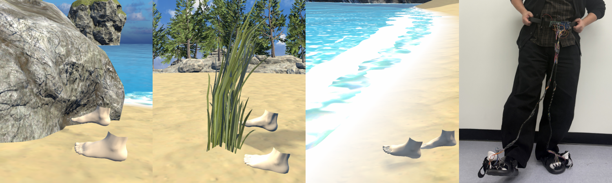
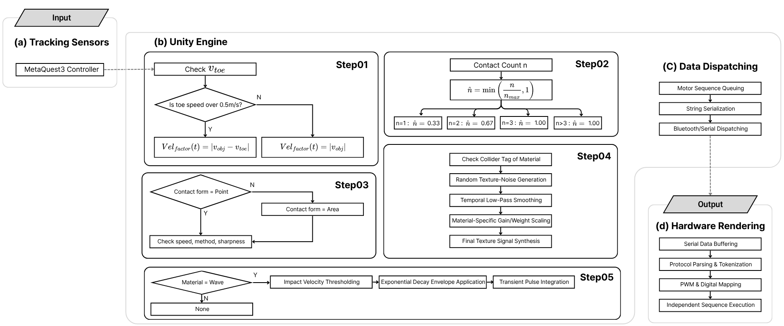
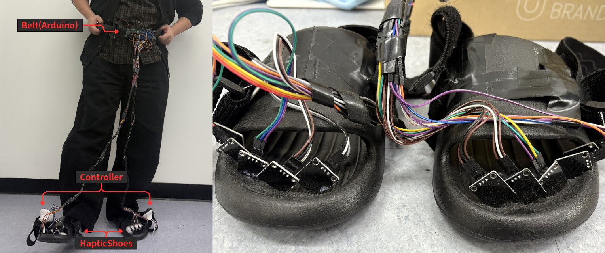

# ToesHaptic

### Evaluating Integrated Toe-Level Vibrotactile Feedback for Virtual-Foot Embodiment in VR

**Moonsu Jang · HyungSeok Kim · Youngwoon Cha**  
Konkuk University

**Code: Coming soon · Demo: Coming soon**

---

*ToesHaptic study context. From left to right: Stone, Grass, and Wave interactions in VR, followed by the toe-worn actuator apparatus.*

## Abstract

Feet support locomotion and object interaction in virtual reality (VR), yet foot haptics commonly stimulate the sole or shoe as a broad region. We investigate toe-local, interaction-contingent vibrotactile feedback using ToesHaptic, which routes virtual toe contacts to ten addressable motor channels. We document its procedural command equations, source-default parameters, and post hoc software-level characterization; these describe scheduled 8-bit commands rather than physical actuator output or perceptual optimality. In a counterbalanced within-participant study, 35 participants experienced fixed, speed/impact-responsive, material-responsive, and integrated feedback. The integrated condition received higher avatar-embodiment and study-specific haptic-appraisal ratings than all comparisons, including across four embodiment subscales. Evidence for overall presence was less consistent because a parametric effect did not remain significant in a nonparametric sensitivity analysis. The findings therefore concern virtual-foot embodiment rather than global immersion, subject to bundled components, unmatched vibration output, subjective measures, and short-term exposure.

## System Overview

*System overview: tracked motion and virtual contact information are used to generate short motor-command sequences, which are dispatched to the toe-worn apparatus.*

## Hardware Prototype

*The research prototype combines foot-mounted tracking controllers, toe-local vibration actuators, and an Arduino-based controller.*

## Code and Demo

**Coming soon.** The Unity project, hardware setup instructions, and demo materials are being prepared for release.

This repository currently contains the project overview only.
